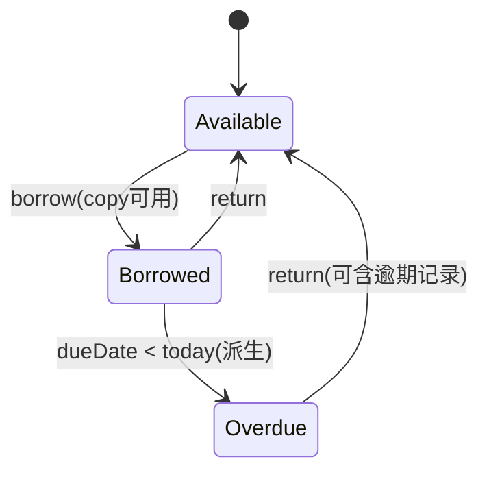

# 电子图书馆

# 核心需求梳理 

|需求|说明|模型|读/写|
|---|---|---|---|
|借阅书籍|借阅必须知道是谁借的，借的什么书，所以系统有【用户】和 【书的元数据】 概念|用户， 书（Book）|写|
||书有库存概念，馆藏量 ≥ 1|库存，BookCopy 对象||
|浏览书籍|查询书，和是否可供借阅（库存剩余）|Book|读|
|查看借阅|借阅是一次动作/行为，可追溯，类似日志。<br>细化：查询【读者】\+ 【副本】 \+ 【借/还时间】 \+ 【尚未归还】的记录||读|
|归还|书库存 \+ 1<br>查看借阅时，可以追溯记录||写|

# 领域模型设计

**业务行为描述：（用户）【借/还】（书）**


**核心行为：借/还**

**借/还产生副作用：库存变化，和借阅记录。**

```Plain Text
Reader ──< Loan >── BookCopy ──< Book
 (1)      (N次借阅行为)                 (1)
```

基于以上：

|限界上下文|职责|聚合根|
|---|---|---|
|目录|书籍 和 副本状态管理|Book， BookCopy|
|借阅（Loan）|借阅规则维护，状态机流转|Loan|
|身份（Identify）|用户（只承载名称）|Reader|



# 领域对象设计

#### 对象属性

|聚合根 |属性 |说明 |
|---|---|---|
|Book|id, title, author, category|书目信息，不含库存状态|
|BookCopy|id, barcode, bookId, status|物理/逻辑副本，借阅的最小单位|
|Reader|id, name, maxActiveLoans=5|只承载借阅约束|
|Loan|id, readerId, copyId, borrowedAt, dueDate, returnedAt, status, renewCount|抽象一次借阅行为|

#### 对象充血模型伪代码

```C++
public class Book {
    private BookId id;
    private Title title;
    private Author author;
    private Category category;

    /** 入库：登记新副本 */
    public BookCopy registerCopy(Barcode barcode) { ... }

    /** 下架：只允许下架未被借出的副本 */
    public void withdrawCopy(CopyId copyId) { ... }
}

public class Reader {
    private ReaderId id;
    private Name name;
    private int maxActiveLoans = 5;  

    /**Reader 自己知道自己的限额 */
    public void verifyCanBorrow(int currentActiveLoans) {
        if (currentActiveLoans >= maxActiveLoans)
            throw new LoanLimitExceededException(id, maxActiveLoans);
    }
}


public class BookCopy {
    private CopyId id;
    private Barcode barcode;
    private BookId bookId;      // 跨聚合用 ID 引用
    private CopyStatus status;  // AVAILABLE | BORROWED
    private long version;       // 乐观锁（@Version，基础设施层注解）

    /** I3 守护：只有 AVAILABLE 副本可被借出 */
    public void lendOut() {
        if (status != AVAILABLE) throw new CopyNotAvailableException(id);
        this.status = BORROWED;
    }

    /** 归还：副本重新回到架位 */
    public void putBack() {
        this.status = AVAILABLE;
    }

    public boolean isAvailable() { return status == AVAILABLE; }
}


```

#### Loan 聚合跟

```TypeScript
public class Loan {
    private LoanId id;
    private ReaderId readerId;   // ID 引用
    private CopyId copyId;       // ID 引用
    private Instant borrowedAt;
    private LocalDate dueDate;
    private Instant returnedAt;  // null = 未归还
    private int renewCount;
    private LoanStatus status;   // ACTIVE | RETURNED（OVERDUE 不落库！）

    /** 工厂方法：创建一次借阅（born ACTIVE） */
    public static Loan borrow(ReaderId readerId, CopyId copyId,
                              Clock clock, LoanPeriod period) {
        return new Loan(..., clock.instant(), clock.today().plus(period),
                        null, 0, ACTIVE);
    }

    /** 最多续借 1 次，且未逾期；新到期日 = 原到期日顺延 */
    public void renew(LoanPeriod period, Clock clock) {
        if (status != ACTIVE)        throw new LoanNotActiveException(id);
        if (renewCount >= 1)         throw new RenewalNotAllowedException(id, "已续借过一次");
        if (clock.today().isAfter(dueDate)) throw new RenewalNotAllowedException(id, "已逾期");
        this.dueDate = dueDate.plus(period);
        this.renewCount++;
    }

    /** 只有 ACTIVE 可归还；归还 = 补记事实，不是删除 */
    public void returnBack(Clock clock) {
        if (status != ACTIVE) throw new LoanNotActiveException(id);
        this.returnedAt = clock.instant();
        this.status = RETURNED;
    }

    /** OVERDUE 为派生状态：查询时计算，数据库不存 */
    public boolean isOverdue(Clock clock) {
        return status == ACTIVE && clock.today().isAfter(dueDate);
    }
}
```

# API 设计

|方法和路径|用途|可能错误|
|---|---|---|
|`GET /books?q=&category=&page=`|浏览/搜索|—|
|`GET /books/{bookId}`|书籍详情（含可借副本数）|`BOOK_NOT_FOUND`|
|`POST /loans`|借阅<br>|`BOOK_NOT_FOUND` / `COPY_NOT_AVAILABLE` / `LOAN_LIMIT_EXCEEDED`|
|`POST /loans/{loanId}/return`|归还|`LOAN_NOT_FOUND` / `LOAN_NOT_ACTIVE`|
|`POST /loans/{loanId}/renewal`|续借（A3）|`RENEWAL_NOT_ALLOWED`|
|`GET /readers/me/loans?status=active`|查看当前借阅|—|

