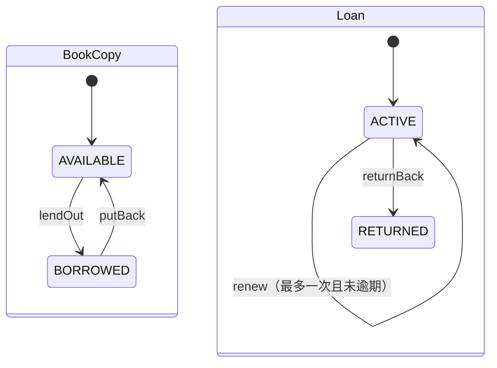

# 领域模型落地说明

需求依据：[电子图书馆.md](电子图书馆.md)。此文件说明原始模型如何对应到实现，以及未明确事项的默认取值。

## 聚合边界

`Book`、`BookCopy`、`Reader`、`Loan` 分别是聚合根。聚合间仅通过 `BookId / CopyId / ReaderId / LoanId` 引用，不使用 ORM 关联或相互包含实体对象。ID 是不同的 Java record 类型，防止把读者 ID 误当作副本 ID。

`Title / Author / Category / Barcode / Name / LoanPeriod` 是值对象，创建时校验。`Book` 不保存库存字段，`Reader` 不保存会与借阅事实重复的当前借阅计数。

领域模型不带 JPA、Spring 或 JSON 注解，不提供通用 setter。数据库映射集中于 `infrastructure.persistence`；`@Version` 属于基础设施实体。

## 行为与规则归属

| 规则 | 执行位置 |
| --- | --- |
| 为书目登记 AVAILABLE 副本 | `Book.registerCopy` |
| 副本必须属于要下架的书目，且馆藏至少剩一个 | `Book.withdrawCopy` |
| 可用副本才能借出，借出副本才能放回 | `BookCopy.lendOut / putBack` |
| 借出副本不可下架，下架副本不可再借 | `BookCopy` |
| 默认 5 本借阅限额 | `Reader.verifyCanBorrow` |
| 创建 ACTIVE 借阅事实和到期日 | `Loan.borrow` |
| 最多续借一次、未逾期、从原到期日延长 | `Loan.renew` |
| 只有 ACTIVE 可以归还，补记归还时间 | `Loan.returnBack` |
| 当前逾期、曾逾期归还 | `Loan.isOverdue / wasReturnedLate` |
| 仓储查询、当前读者归属、锁顺序、事务 | `LibraryService` |
| 持久化、唯一条码、并发防重、外键 | JPA 仓储适配与 Flyway DDL |

`Book.withdrawCopy` 接收副本和当前在馆数，由应用层在锁定书目后加载。原伪代码只传 `CopyId`，纯领域对象无法据此查询另一个聚合状态，因此落地时显式传入所需事实，避免让领域对象持有仓储。

## 状态与时间



`OVERDUE` 不是 `LoanStatus` 枚举值，不在数据库状态机里增加一条持久化状态。查询时：

```text
overdue = status == ACTIVE && 今天 > dueDate
returnedLate = returnedAt != null && 归还时业务日期 > dueDate
```

`borrowedAt / returnedAt` 保存 `Instant`；`dueDate` 保存 `LocalDate`。日期规则由可注入的 `Clock` 及业务时区决定，默认 `Asia/Shanghai`。到期日当天全天均不逾期。创建借阅时先取得单个 Instant，再换算当日日期，避免跨午夜的两次取时不一致。

默认借期为 30 天，续借从原到期日再延长同样天数，可通过配置调整。文档没有“有逾期记录禁止再借”规则，因此实现不额外增加此约束；逾期未还仍然计入活动借阅数。

## 库存和下架

`totalCopies` 为未下架副本总数，`availableCopies` 为未下架且状态 AVAILABLE 的副本数。库存变化来自 `BookCopy` 状态迁移，归还不会新增副本。

首次入库必须至少带一个副本。文档要求馆藏量 ≥ 1，因此实现也禁止下架最后一个在馆副本。若将来需要整本书目下架，可新增书目生命周期规则，不能通过删掉最后一个副本绕过。

原模型的两个副本状态保留为 AVAILABLE/BORROWED。为支持下架同时保留历史外键，额外增加 `withdrawnAt` 事实；下架后条码不复用、历史副本行不删除。图书详情只列出在馆副本，历史 Loan 仍保留原 copyId。

## 一致性

四个聚合根在当前单体、单数据库内由应用事务协调。借阅、归还均在同一事务提交借阅状态与副本状态。

- 借阅：书目存在 → 锁 Reader → 统计 ACTIVE → 校验限额 → 锁 BookCopy → lendOut → 创建 Loan → 保存。
- 归还：锁 Reader → 锁 Loan → 核验归属 → 锁 BookCopy → returnBack + putBack → 保存。
- 续借：锁 Reader → 锁 Loan → 核验归属 → renew → 保存。
- 入库副本/下架：锁 Book → 下架时再锁 BookCopy → 读取在馆数 → 领域校验 → 保存。

读者行锁避免并发请求都读到 4 本然后分别借出导致 6 本；副本行锁避免重复借出。新增副本和下架锁书目，避免两个下架请求都读到 2 本后各删一个。

`active_copy_loans` 是持久化防重结构，不是第五个业务聚合。借出时插入 `(copy_id, loan_id)`，归还时移除，借阅事实始终保留在 loans。主键保证每个副本最多一条活动映射。数据库外键和检查约束另行保护历史引用、状态与归还时间的基本一致性。

书目浏览用一次分组查询统计当前页各书目库存，避免对每本书单独查询副本。

## 当前边界

原文未定义读者认证、管理员授权、预约、罚款、电子书下载、书目编辑和用户注销。本项目完成领域对象与 API，不引入这些业务。`X-Reader-Id` 是方便本地使用的当前读者适配点，后续可替换成安全上下文解析而无需改变领域对象。

数据库目前以 H2 文件方式本地运行，以 H2 内存方式执行集成测试；未宣称完成其他数据库或多数据库分布式事务验证。
